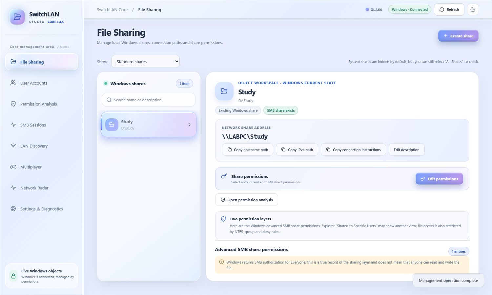

# SwitchLAN Studio

**A Windows desktop console for local accounts, SMB file sharing, LAN discovery and multiplayer diagnostics.**

[中文版 / Chinese edition](https://github.com/RatscOvO/SwitchLAN-Studio/tree/zh-CN)

Core **1.4.5 Beta · English edition**. Built with C#/.NET 8, WinForms, WebView2 and Windows PowerShell 5.1. The HTML interface runs inside the desktop application.



## What it does

- Manage standard local accounts: create accounts, edit details, enable or disable accounts, reset passwords and perform guarded deletion.
- Create SMB shares for existing folders, edit share descriptions and direct SMB permissions, and stop sharing while keeping local files.
- Inspect SMB and NTFS permission entries alongside local group membership. This is evidence for troubleshooting, not a calculation of effective access.
- View inbound SMB sessions and open files when Windows grants the required read permissions.
- Discover devices on an authorized private IPv4 /24 subnet and test whether the current account can list a shared folder.
- Discover Minecraft Java/Bedrock endpoints and probe selected ports for other games.
- Monitor measured ICMP round-trip times, optional TCP reachability and local adapter traffic with Network Radar.

## Requirements

- Windows 11 x64 is the intended target. Other Windows versions have not been validated for this release.
- [.NET 8 SDK x64](https://dotnet.microsoft.com/download/dotnet/8.0) to build from source. A packaged framework-dependent build needs the .NET 8 Windows Desktop Runtime instead.
- [Microsoft Edge WebView2 Runtime](https://developer.microsoft.com/microsoft-edge/webview2/).
- Windows PowerShell 5.1 and Windows networking/account-management modules.
- Internet access for the first NuGet package restore.

## Run from source

Download and extract the complete repository, then double-click **`Start-SwitchLAN.cmd`**. It builds the current source and launches the desktop window.

Or use PowerShell from the repository root:

```powershell
dotnet build .\desktop\SwitchLAN.Desktop\SwitchLAN.Desktop.csproj -c Release
dotnet .\desktop\SwitchLAN.Desktop\bin\Release\net8.0-windows\SwitchLAN.Desktop.dll
```

Opening `index.html` in a browser does not enable Windows management. A disconnected browser view never invents local accounts, shares or network measurements.

The main window runs without elevation. Write operations request UAC through a fixed, one-shot PowerShell helper. Protected accounts and system shares cannot be modified through the normal management actions.

## English edition

The interface, confirmations, application-generated native errors, PowerShell diagnostics and launch instructions are in English. Dates and times use the `en-US` display locale; your system time zone is retained. Account names, share names, paths, server descriptions and Windows-generated error messages remain as supplied by Windows or the remote device.

This edition uses the same local data locations and managed-object markers as the Chinese edition. Run one edition at a time. The two editions operate on the same Windows accounts and shares.

## Checks

Read-only source checks:

```powershell
node tests/test-policy.js
python -X utf8 tests/test-core14-static.py
python -X utf8 tests/test-core131-static.py
powershell -NoProfile -ExecutionPolicy Bypass -File tests/Check-PowerShellScripts.ps1
dotnet build desktop/SwitchLAN.Desktop/SwitchLAN.Desktop.csproj -c Release
```

Browser regression tests use synthetic Windows data and require Python Playwright:

```powershell
python -m pip install -r tests/requirements.txt
python -m playwright install chromium
python -X utf8 tests/browser-english.py
python -X utf8 tests/browser-ux145.py
python -X utf8 tests/browser-core14.py
python -X utf8 tests/browser-games141.py
python -X utf8 tests/browser-radar144.py
```

See [validation notes](docs/VALIDATION.md) for what was checked and what still requires a dedicated Windows test setup. Build success and simulated UI checks do not verify UAC, real account changes, NTFS cleanup or access from another PC.

## Data and privacy

Local state and reports are stored under `%LOCALAPPDATA%\SwitchLAN Studio`; the managed-object registry is `%PROGRAMDATA%\SwitchLAN Studio\managed.json`. The desktop log is `%TEMP%\SwitchLAN.Desktop.log`.

Snapshots, diagnostic reports and screenshots can contain account names, SIDs, IP addresses, hostnames and private paths. Redact them before attaching them to issues. Never publish generated passwords or temporary request/result files. These runtime files and build outputs are excluded by `.gitignore`.

## Project layout

| Path | Purpose |
| --- | --- |
| `desktop/SwitchLAN.Desktop/` | Windows host, fixed UI bridge and network probes |
| `backend/` | Read-only Windows collectors |
| `backend/Stage2/` | Guarded, one-shot elevated management helper and opt-in integration tests |
| `js/`, `assets/`, `index.html` | Embedded interface |
| `tests/` | Policy, encoding, structure and simulated browser checks |
| `tools/` | Read-only startup checks |

## Contributing and license

Read [CONTRIBUTING.md](CONTRIBUTING.md) and [SECURITY.md](SECURITY.md) before changing the management layer. Report bugs using the issue templates; include redacted errors and reproduction steps.

Project code is released under the [MIT License](LICENSE). See [THIRD_PARTY_NOTICES.md](THIRD_PARTY_NOTICES.md) for third-party attribution. SwitchLAN Studio is independent of Microsoft, Apple and the game vendors mentioned here.
